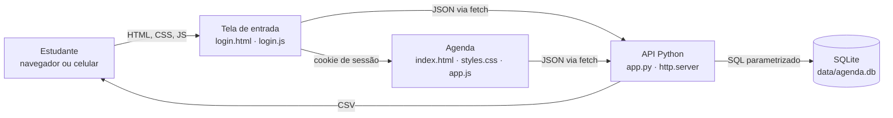

# Documentação do projeto — Agenda Acadêmica

**Autor:** Gustavo Emanoel Bianchini — RGM 33636541
**Versão documentada:** 2.3 (17/11/2026). A versão 1.0 (08/11/2026) continua disponível na pasta `versao-1`.

## 1. Identificação e objetivo

| Item | Descrição |
| --- | --- |
| Nome do sistema | Agenda Acadêmica |
| Objetivo | Ajudar estudantes a acompanhar prazos de trabalhos, provas e atividades em uma única lista. |
| Público-alvo | Estudantes de graduação e ensino médio com tarefas de várias disciplinas. |
| Problema tratado | Prazos anotados em lugares diferentes (caderno, mensagens, avisos do professor) são esquecidos ou difíceis de priorizar. |
| Solução | Aplicação web simples, que funciona no computador e no celular, com conta própria para cada estudante, cadastro de tarefas, prazos, prioridades e filtros. |

## 2. Escopo

### Versão 1.0
Cadastro, consulta, edição, conclusão, reabertura e exclusão de tarefas; filtros (todas, pendentes, concluídas); resumo com totais; destaque de tarefas atrasadas; persistência em SQLite; plano inicial com as etapas da PIT em um banco novo.

### Versão 2.0
Tudo da versão 1.0, mais: busca, prioridade, filtro e contador de atrasadas, prazo relativo, ordenação, exportação para planilha, sugestão de disciplinas, contador de caracteres e as correções descritas no [laudo de qualidade](LAUDO_QUALIDADE.md).

### Versão 2.1
Acesso protegido por usuário e senha na versão publicada.

### Versão 2.2
Horário de entrega opcional e cor de cada tarefa pendente conforme o tempo que falta, sugestão feita nos testes com colegas.

### Versão 2.3
Contas de usuário: cada pessoa cria a sua conta (nome, usuário, senha e pergunta secreta) e vê só a própria lista; recuperação de senha pela pergunta secreta. Substitui a senha única da versão 2.1.

### Fora do escopo
Compartilhamento de agenda entre pessoas, recuperação de senha por e-mail, notificações por e-mail ou celular e sincronização com calendários externos.

## 3. Requisitos funcionais

| Código | Requisito | Critério de aceitação | Versão |
| --- | --- | --- | --- |
| RF01 | Cadastrar tarefa | Uma tarefa com título, disciplina e data válidos aparece na lista após salvar. | 1.0 |
| RF02 | Consultar tarefas | A lista é carregada do banco ao abrir ou atualizar a página. | 1.0 |
| RF03 | Editar tarefa | Título, disciplina, prazo (data e horário), prioridade e observações podem ser alterados. | 1.0 / 2.0 / 2.2 |
| RF04 | Concluir e reabrir | Um clique marca a tarefa como concluída; outro clique a reabre. | 1.0 |
| RF05 | Excluir tarefa | A tarefa só é removida após confirmação. | 1.0 |
| RF06 | Filtrar lista | Filtros "Todas", "Pendentes", "Atrasadas" e "Concluídas". | 1.0 / 2.0 |
| RF07 | Exibir resumo | Cartões com total, pendentes, atrasadas e concluídas. | 1.0 / 2.0 |
| RF08 | Buscar tarefas | O texto digitado filtra por título, disciplina ou observação, sem diferenciar acentos. | 2.0 |
| RF09 | Definir prioridade | Cada tarefa tem prioridade baixa, média (padrão) ou alta. | 2.0 |
| RF10 | Ordenar lista | Ordenação por prazo, prioridade ou disciplina. | 2.0 |
| RF11 | Mostrar prazo relativo | A lista indica "Vence hoje", "Vence amanhã", "Faltam N dias" ou "Atrasada há N dias" e, nas últimas 6 horas, o tempo restante em horas e minutos. | 2.0 / 2.2 |
| RF12 | Exportar planilha | O botão "Exportar planilha" baixa um arquivo CSV que abre no Excel com acentos corretos. | 2.0 |
| RF13 | Sugerir disciplinas | O campo disciplina sugere os nomes já cadastrados. | 2.0 |
| RF14 | Informar horário de entrega | O horário é opcional; sem ele, o prazo vale até 23:59 do dia. | 2.2 |
| RF15 | Indicar a urgência por cor | Tarefas pendentes ficam verdes (mais de 6 horas), amarelas (menos de 6 horas), laranja (menos de 1 hora) ou vermelhas (prazo encerrado), com legenda; a cor se atualiza a cada minuto. | 2.2 |
| RF16 | Criar conta | Nome, usuário (3 a 30 caracteres, sem acento), senha (mínimo 8) e pergunta secreta com resposta; ao criar, a pessoa já entra na agenda. | 2.3 |
| RF17 | Entrar e sair | Usuário e senha corretos abrem a agenda da pessoa; "Sair" encerra a sessão. Sem login, a agenda e a API não abrem. | 2.3 |
| RF18 | Recuperar a senha | Informando o usuário, a pessoa vê a própria pergunta secreta; com a resposta certa, define uma nova senha. | 2.3 |
| RF19 | Separar as listas por conta | Cada conta vê, altera, exclui e exporta somente as próprias tarefas. | 2.3 |

## 4. Requisitos não funcionais

| Código | Requisito |
| --- | --- |
| RNF01 | **Usabilidade:** interface em português, mensagens de erro claras e visíveis, confirmação antes de ações que apagam dados. |
| RNF02 | **Responsividade:** uso confortável de 320 px (celular) até telas grandes, sem rolagem horizontal. |
| RNF03 | **Portabilidade:** Python 3.10 ou superior, sem bibliotecas externas; roda em Windows, macOS e Linux. |
| RNF04 | **Persistência:** dados gravados em SQLite e mantidos após fechar e abrir a aplicação. |
| RNF05 | **Segurança:** validação no servidor, SQL parametrizado, textos exibidos com `textContent` (sem interpretar HTML), limite de 4 KB por requisição, proteção contra fórmulas no CSV exportado e contas de usuário: senhas e respostas secretas guardadas só como hash PBKDF2-SHA256 com sal, sessão em cookie `HttpOnly`/`SameSite=Lax`, bloqueio de 15 minutos após 5 tentativas erradas e consultas sempre filtradas pela conta. |
| RNF06 | **Acessibilidade:** rótulos nos campos, `aria-label` nos botões de ícone, foco visível e respeito à preferência de movimento reduzido. |
| RNF07 | **Manutenibilidade:** testes automatizados de integração para a API e para a migração do banco. |
| RNF08 | **Implantação:** endereço (`HOST`), porta (`PORT`), banco (`AGENDA_DB_PATH`) e conta do avaliador (`AGENDA_USUARIO`, `AGENDA_SENHA`) configuráveis por variáveis de ambiente. |

## 5. Regras de negócio

- RN01: título (até 120 caracteres) e disciplina (até 80) são obrigatórios; espaços isolados não são aceitos.
- RN02: a data de entrega deve existir no calendário (formato `AAAA-MM-DD`); o horário, se informado, usa o formato `HH:MM` de 24 horas.
- RN03: observações são opcionais, com até 500 caracteres.
- RN04: toda tarefa nova começa pendente e com prioridade média, se outra não for escolhida.
- RN05: uma tarefa pendente cujo prazo (data e horário; sem horário, 23:59) já passou é considerada atrasada.
- RN06: ao salvar uma tarefa pendente com prazo já passado, o sistema pede confirmação.
- RN07: excluir uma tarefa ou descartar um formulário com alterações exige confirmação.
- RN08: a lista mostra primeiro as pendentes, pelo prazo mais próximo (data e horário) e, no mesmo prazo, pela prioridade mais alta.
- RN09: o plano inicial da PIT é incluído apenas quando o banco é criado; depois, as tarefas podem ser editadas ou excluídas normalmente.
- RN10: a cor de urgência vale só para tarefas pendentes; concluídas ficam sem cor.
- RN11: o usuário é único, sem diferenciar maiúsculas e minúsculas ("Ana" e "ana" são o mesmo usuário).
- RN12: na resposta secreta, maiúsculas, acentos e espaços a mais não fazem diferença.
- RN13: depois de 5 tentativas erradas de senha (ou de resposta secreta) para o mesmo usuário, novas tentativas ficam bloqueadas por 15 minutos.
- RN14: trocar a senha pela pergunta secreta encerra a sessão em todos os aparelhos; a sessão dura 7 dias.
- RN15: tarefas sem dono (plano inicial e bancos das versões anteriores) passam para a primeira conta criada; na hospedagem, para a conta do avaliador. Contas novas começam com a lista vazia.

## 6. Casos de uso

Ator: **Estudante**.

| Caso de uso | Fluxo principal | Fluxos alternativos |
| --- | --- | --- |
| UC01 — Cadastrar tarefa | Clicar em "Nova tarefa", preencher os campos e salvar. | Campo inválido: mensagem dentro do formulário. Data passada: pedido de confirmação. Fechar com dados digitados: pedido de confirmação. |
| UC02 — Acompanhar tarefas | Ver o resumo, buscar, filtrar e ordenar a lista. | Nenhum resultado: mensagem orientando a mudar a busca ou o filtro. |
| UC03 — Atualizar tarefa | Editar dados, concluir ou reabrir. | Servidor indisponível: mensagem em português. |
| UC04 — Excluir tarefa | Clicar no "×" e confirmar. | Cancelar mantém a tarefa. |
| UC05 — Exportar planilha | Clicar em "Exportar planilha" e abrir o arquivo. | — |
| UC06 — Criar conta | Na tela de entrada, abrir "Criar conta", preencher nome, usuário, senha, pergunta secreta e resposta. | Usuário já usado, senha curta ou senhas diferentes: mensagem dentro do formulário. |
| UC07 — Entrar e sair | Informar usuário e senha; usar "Sair" no topo da agenda. | Dados errados: "Usuário ou senha incorretos."; 5 erros seguidos: bloqueio de 15 minutos. |
| UC08 — Recuperar senha | "Esqueci minha senha", informar o usuário, responder à pergunta e escolher a nova senha. | Resposta errada: "Resposta incorreta."; conta sem pergunta secreta (conta do avaliador): orientação para falar com o administrador. |

## 7. Arquitetura

- **Interface:** HTML, CSS e JavaScript puros. Busca, filtros, ordenação, prazo relativo e cores de urgência são calculados no navegador a partir da lista recebida.
- **Servidor:** Python 3 com `http.server` (`ThreadingHTTPServer`). Confere a sessão de cada pedido, valida os dados, grava no banco e devolve JSON. Senhas são verificadas com `hashlib.pbkdf2_hmac` e `secrets.compare_digest` (biblioteca padrão).
- **Banco:** SQLite, criado automaticamente. A função `migrate` atualiza bancos das versões 1.0, 2.1 e 2.2.

## 8. Modelo de dados

Tabela `tasks`:

| Coluna | Tipo | Regra |
| --- | --- | --- |
| `id` | INTEGER | Chave primária, autoincremento. |
| `title` | TEXT | Obrigatório. |
| `subject` | TEXT | Obrigatório. |
| `due_date` | TEXT | Data `AAAA-MM-DD`. |
| `due_time` | TEXT | Horário `HH:MM` ou vazio (até 23:59) (versão 2.2). |
| `notes` | TEXT | Padrão vazio. |
| `completed` | INTEGER | 0 ou 1. |
| `priority` | TEXT | `baixa`, `media` ou `alta`; padrão `media` (versão 2.0). |
| `user_id` | INTEGER | Conta dona da tarefa (versão 2.3). |
| `created_at` / `updated_at` | TEXT | Data e hora em UTC. |

Tabela `users` (versão 2.3):

| Coluna | Tipo | Regra |
| --- | --- | --- |
| `id` | INTEGER | Chave primária, autoincremento. |
| `name` | TEXT | Nome exibido no topo da agenda. |
| `username` | TEXT | Único, em minúsculas. |
| `password_hash` | TEXT | `pbkdf2_sha256$iterações$sal$hash`; a senha nunca é gravada. |
| `question` | TEXT | Pergunta secreta criada pela pessoa (vazia na conta do avaliador). |
| `answer_hash` | TEXT | Hash da resposta já normalizada (sem acentos, maiúsculas e espaços a mais). |
| `created_at` | TEXT | Data e hora em UTC. |

Tabela `sessions` (versão 2.3): `token_hash` (SHA-256 do token do cookie), `user_id` e `expires_at` (7 dias).

## 9. API

| Método | Rota | Finalidade |
| --- | --- | --- |
| GET | `/login` | Tela de entrada (aberta). Quem já entrou é levado para a agenda. |
| POST | `/api/register` | Criar conta e entrar (versão 2.3). |
| POST | `/api/login` / `/api/logout` | Entrar e sair (versão 2.3). |
| POST | `/api/password/question` | Mostrar a pergunta secreta de um usuário (versão 2.3). |
| POST | `/api/password/reset` | Trocar a senha com a resposta certa (versão 2.3). |
| GET | `/api/me` | Nome e usuário da conta conectada (versão 2.3). |
| GET | `/api/tasks` | Listar tarefas da conta. |
| POST | `/api/tasks` | Cadastrar tarefa. |
| PUT | `/api/tasks/{id}` | Editar dados, estado ou prioridade. |
| DELETE | `/api/tasks/{id}` | Excluir tarefa. |
| GET | `/api/tasks/export.csv` | Baixar a lista em CSV (versão 2.0). |
| GET | `/health` | Verificar se o servidor responde e qual a versão (sempre aberta). |

Erros de validação retornam HTTP 400 com `{"error": "mensagem em português"}`; tarefas inexistentes ou de outra conta retornam 404. Sem sessão, a API retorna 401 e a página `/` redireciona para `/login`; usuário repetido retorna 409 e tentativas bloqueadas, 429.

## 10. Execução e publicação

- **Local:** `cd versao-2 && python3 app.py`, acessar `http://127.0.0.1:8000` e criar uma conta.
- **Celular na mesma rede:** `HOST=0.0.0.0 python3 app.py`; o terminal mostra o endereço a ser aberto no celular.
- **Hospedagem (Render):** o arquivo `render.yaml` publica a pasta `versao-2` como serviço web gratuito. Qualquer pessoa pode criar a sua conta pela tela de entrada e vê só a própria lista. A variável `AGENDA_SENHA` cria, a cada inicialização, a conta do avaliador (usuário `avaliador`, ou o definido em `AGENDA_USUARIO`), que recebe o plano inicial da PIT. No plano gratuito, o disco é temporário: quando o serviço reinicia, o banco volta ao plano inicial e as contas criadas pela tela são apagadas (a do avaliador é recriada). Para guardar dados permanentemente seria necessário um disco persistente ou outro banco.

## 11. Qualidade

Testes automatizados (23 na versão 2.3) cobrem cadastro, consulta, edição, conclusão, reabertura, exclusão, gravação no banco, prioridade, ordenação, exportação CSV, horário de entrega, migração dos bancos das versões 1.0 e 2.2, dados inválidos, rotas inexistentes, porta ocupada, criação de conta, login e logout, listas separadas por conta, recuperação de senha, bloqueio por tentativas erradas, senhas guardadas só como hash, conta do avaliador, requisições HEAD e mensagem de inicialização na hospedagem. O [laudo de qualidade](LAUDO_QUALIDADE.md) registra os problemas encontrados, as correções e as evidências.

## 12. Histórico de versões

| Versão | Data | Resumo |
| --- | --- | --- |
| 1.0 | 08/11/2026 | Primeira versão funcional. |
| 2.0 | 16/11/2026 | Novas funcionalidades e correções após os testes da versão 1.0. Detalhes em [CHANGELOG.md](../CHANGELOG.md). |
| 2.1 | 16/11/2026 | Acesso por usuário e senha na versão publicada. |
| 2.2 | 17/11/2026 | Horário de entrega e cores por prazo, sugestão dos testes com colegas. |
| 2.3 | 17/11/2026 | Contas de usuário com recuperação de senha por pergunta secreta. |
